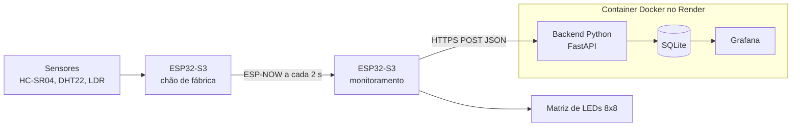
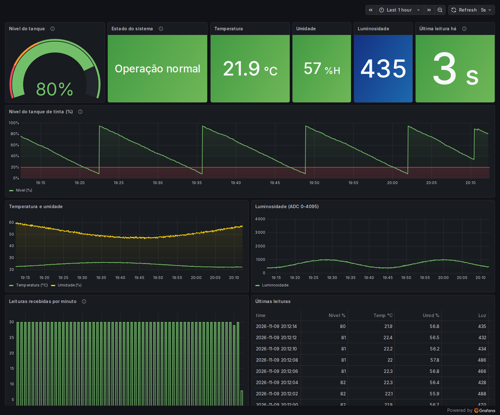

# Monitoramento do Processo de Pintura com ESP32, ESP-NOW, SQLite e Grafana

Projeto da AV2 da disciplina **Práticas Integradas: Camada de Serviço**.

Sistema IoT que acompanha o processo de pintura de blocos de madeira em um chão de fábrica simulado. Um ESP32 lê os sensores do tanque de tinta e envia as leituras por ESP-NOW para um segundo ESP32, que mostra os valores numa matriz de LEDs e encaminha tudo para um backend em Python. O backend grava no SQLite e o Grafana exibe os dashboards em tempo real. Backend, banco e Grafana rodam juntos em um container Docker, hospedado no Render.

## Integrantes

- Felipe Nogueira
- Lucas Choucate
- Rafael Cezimbra 
- Ramon Papes


## Arquitetura



## Estrutura do repositório

```
.
├── firmware/
│   ├── chao-de-fabrica/      # ESP32 que lê os sensores e envia por ESP-NOW
│   ├── monitoramento/        # ESP32 que recebe, exibe na matriz e envia ao backend
│   └── utilitarios/ler-mac/  # Sketch auxiliar para descobrir o MAC de cada placa
├── backend/                  # API FastAPI + SQLite + Grafana (Docker)
├── docs/
│   ├── circuito.md           # Ligações de cada componente
│   ├── banco-de-dados.md     # Descrição do banco SQLite
│   ├── grafana.md            # Descrição dos dashboards
│   └── img/grafana.png       # Print do dashboard
├── render.yaml               # Deploy do backend no Render (Blueprint)
└── README.md
```

## Materiais

| Item | Quantidade |
|---|---|
| ESP32-S3 | 2 |
| Sensor ultrassônico HC-SR04 | 1 |
| Sensor de temperatura e umidade DHT22 | 1 |
| Fotorresistor (LDR) | 1 |
| Matriz de LEDs 8x8 com MAX7219 (1088AS) | 1 |
| LED verde | 1 |
| LED vermelho | 1 |
| Resistores, protoboard e jumpers | diversos |
| Computador com Arduino IDE (o backend e o Grafana rodam no Render ou no Docker) | 1 |

## Como montar o projeto

A pinagem completa está em [docs/circuito.md](docs/circuito.md). Resumo:

| ESP32 | Componente | GPIO |
|---|---|---|
| Chão de fábrica | HC-SR04 TRIG / ECHO | 4 / 5 |
| Chão de fábrica | DHT22 | 6 |
| Chão de fábrica | LDR | 7 |
| Chão de fábrica | LED verde / LED vermelho | 15 / 16 |
| Monitoramento | Matriz DIN / CS / CLK | 13 / 14 / 15 |

### 1. Preparar a Arduino IDE

1. Instale a placa **esp32 by Espressif Systems** (versão 3.x recente) pelo Gerenciador de Placas. O firmware usa a assinatura nova do callback de envio do ESP-NOW (`wifi_tx_info_t`), que não existe nas versões 2.x.
2. Instale as bibliotecas pelo Gerenciador de Bibliotecas:
   - **DHT sensor library** (Adafruit), que também pede a **Adafruit Unified Sensor**
   - **MD_Parola** e **MD_MAX72XX** (majicDesigns)
3. Selecione a placa ESP32S3 Dev Module.

### 2. Descobrir o MAC de cada placa

Grave `firmware/utilitarios/ler-mac/ler-mac.ino` em cada ESP32 e abra o Monitor Serial (115200). Anote a linha "Para ESP-NOW" de cada um.

### 3. Configurar os segredos

Em cada pasta de firmware, copie `secrets.example.h` para `secrets.h` e preencha. O `secrets.h` está no `.gitignore` e não deve ir para o GitHub.

| Arquivo | Campo | O que colocar |
|---|---|---|
| `monitoramento/secrets.h` | `WIFI_SSID`, `WIFI_PASSWORD` | Rede Wi-Fi 2.4 GHz |
| `monitoramento/secrets.h` | `BACKEND_URL` | `https://SEU-APP.onrender.com/api/leituras` (Render) ou `http://IP_DO_COMPUTADOR:8080/api/leituras` (Docker local) |
| `monitoramento/secrets.h` | `MAC_CHAO_FABRICA` | MAC do ESP32 chão de fábrica |
| `chao-de-fabrica/secrets.h` | `MAC_MONITORAMENTO` | MAC do ESP32 de monitoramento |
| `chao-de-fabrica/secrets.h` | `WIFI_CHANNEL` | Canal do roteador (ver passo 4) |

### 4. Gravar os firmwares

1. Grave o **monitoramento** primeiro. Ao conectar no Wi-Fi ele imprime no Serial a linha `Canal do roteador: X`.
2. Coloque esse número em `WIFI_CHANNEL` no `secrets.h` do chão de fábrica. Os dois ESP32 precisam estar no mesmo canal, senão o ESP-NOW não chega.
3. Grave o **chão de fábrica**.

## Funcionamento

**Chão de fábrica.** A cada 2 s lê o nível do tanque (100 cm = 0%, 10 cm = 100%), a temperatura, a umidade e a luminosidade, mostra tudo no Monitor Serial e envia o pacote por ESP-NOW. LED verde aceso indica operação normal; abaixo de 20% de tinta acende o vermelho e o Serial mostra "Alerta! Nível de tinta baixo.".

**Monitoramento.** Aceita pacotes apenas do MAC do chão de fábrica. Exibe em rolagem na matriz as telas `NVL`, `TMP`, `UMD` e `LUX`. Se ficar mais de 5 s sem receber, mostra `SEM DADOS`. Cada pacote recebido ganha um timestamp ISO 8601 em UTC (hora obtida por NTP) e é enviado ao backend por HTTP.

Formato enviado ao backend:

```json
{
  "nivel_tinta": 75,
  "temperatura": 24.10,
  "umidade": 55.00,
  "luminosidade": 680,
  "timestamp": "2025-09-02T14:35:00Z",
  "uptime_emissor_ms": 123456
}
```

O `timestamp` vem como `null` enquanto o NTP não sincroniza; nesse caso o backend usa a própria hora. Se o DHT22 falhar, o firmware escreve `nan` em `temperatura`/`umidade`; o backend grava esses campos como `null`.

## Como rodar o backend

O backend fica em [backend/](backend/): uma API em FastAPI que grava no SQLite e um Grafana já configurado, rodando juntos em um único container Docker. Detalhes em [backend/README.md](backend/README.md).

**No Render (produção).** O [render.yaml](render.yaml) da raiz cria o serviço:

1. No Render, **New + → Blueprint**, escolha este repositório e a branch.
2. Clique em **Apply** e espere o status **Live**.
3. Use `https://SEU-APP.onrender.com/api/leituras` como `BACKEND_URL` do monitoramento.

Nenhuma variável de ambiente precisa ser preenchida: o Render gera a senha do admin do Grafana (`GF_SECURITY_ADMIN_PASSWORD`) e as demais já têm valor padrão. No plano gratuito, o banco é apagado a cada deploy ou reinício do serviço.

**Localmente (Docker).** Com o Docker instalado:

```bash
cd backend
docker compose up --build
```

API em `http://localhost:8080/docs` e Grafana em `http://localhost:8080/grafana/`. Para o ESP32 alcançar o computador, use o IP dele na rede (ex.: `http://192.168.0.10:8080/api/leituras`).

Sem o hardware, dá para testar com o simulador: `python backend/scripts/simular_esp.py --url http://localhost:8080`.

> O monitoramento espera no máximo 1,5 s pela resposta (`HTTP_TIMEOUT_MS`). No Render, a conexão HTTPS pode demorar mais que isso. Se o Serial mostrar `Backend: falha de conexão (read Timeout)`, aumente esse valor para 5000.

## Banco de dados e Grafana

- Descrição do banco: [docs/banco-de-dados.md](docs/banco-de-dados.md)
- Descrição dos dashboards: [docs/grafana.md](docs/grafana.md)



## Como consultar os dados salvos

- **Grafana:** `https://SEU-APP.onrender.com/grafana/`, com o dashboard "Processo de Pintura – Chão de Fábrica" e a tabela das últimas leituras. Não precisa de login.
- **API (navegador ou `curl`):**

| Rota | O que retorna |
|---|---|
| `GET /api/leituras?limit=50` | Últimas leituras em JSON (filtros `inicio` e `fim` em ISO 8601) |
| `GET /api/leituras/ultima` | Leitura mais recente |
| `GET /api/leituras.csv` | Leituras em CSV, abre no Excel (até 10.000 por padrão; ajuste com `limit`) |
| `GET /api/resumo?horas=24` | Nível mínimo, máximo e médio, médias de temperatura, umidade e luz, total de alertas |
| `GET /docs` | Documentação interativa (Swagger) |

- **SQL direto no banco** (local com `docker compose exec pintura-iot bash`; no Render, pela aba **Shell**, disponível só nos planos pagos):

```bash
sqlite3 /data/pintura.db "SELECT datetime(ts,'unixepoch') AS hora, nivel_tinta, temperatura, umidade, luminosidade FROM leituras ORDER BY ts DESC LIMIT 10;"
```

## Dificuldades e soluções

### 1. [PREENCHER: título da dificuldade]

**Problema:** [PREENCHER]

**Solução:** [PREENCHER]

### 2. [PREENCHER: título da dificuldade]

**Problema:** [PREENCHER]

**Solução:** [PREENCHER]

### 3. [PREENCHER: título da dificuldade]

**Problema:** [PREENCHER]

**Solução:** [PREENCHER]

## Observações

- O sensor de presença (PIR) e os LEDs de status do ESP32 de monitoramento foram dispensados pelo professor e não fazem parte do projeto.
- Os dois controladores são ESP32-S3. Num ESP32 comum os GPIO 6 e 7 são ligados à memória flash e não podem ser usados para sensores.
