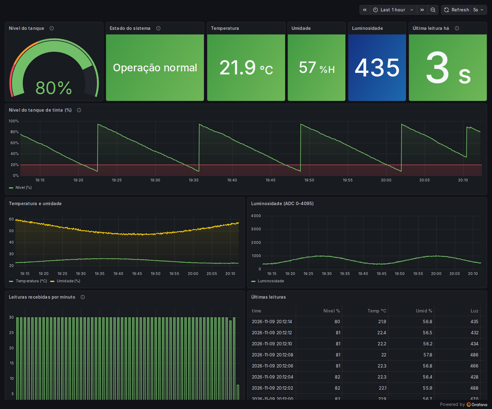

# Grafana

O Grafana roda no mesmo container do backend e já sobe configurado: a fonte de dados e o dashboard são
carregados automaticamente (provisionamento), sem nenhum passo manual.

## Acesso

| Item | Valor |
|---|---|
| Endereço | `https://SEU-APP.onrender.com/grafana/` (Render) ou `http://localhost:8080/grafana/` (Docker local) |
| Login | Não precisa para visualizar (acesso anônimo, somente leitura). Para editar: usuário `admin`, senha em `GF_SECURITY_ADMIN_PASSWORD` |
| Versão | Grafana 12.4 |
| Fonte de dados | SQLite, pelo plugin [`frser-sqlite-datasource`](https://grafana.com/grafana/plugins/frser-sqlite-datasource/) 4.0.6, apontando para `/data/pintura.db`. Consultas em SQL |
| Atualização automática | A cada 5 s, mostrando a última 1 hora |



*Print feito com dados do simulador (`backend/scripts/simular_esp.py`).*

## Painéis

Dashboard **Processo de Pintura – Chão de Fábrica** (pasta *IoT*, também é a página inicial do Grafana).

| Painel | Tipo | Campo | Detalhe |
|---|---|---|---|
| Nível do tanque | Medidor (gauge) | `nivel_tinta` | Última leitura. Vermelho abaixo de 20 %, laranja até 40 %, verde acima |
| Estado do sistema | Stat | `alerta` | "Operação normal" (verde) ou "ALERTA – verificar tanque" (vermelho) |
| Temperatura | Stat | `temperatura` | Última leitura em °C |
| Umidade | Stat | `umidade` | Última leitura em % |
| Luminosidade | Stat | `luminosidade` | Última leitura do LDR (0 a 4095) |
| Última leitura há | Stat | `ts` | Segundos desde a última leitura. Verde até 10 s, laranja até 30 s, vermelho acima: mostra se o ESP32 parou de enviar |
| Nível do tanque de tinta (%) | Série temporal | `nivel_tinta` | Faixa vermelha destacando o nível crítico (< 20 %) |
| Temperatura e umidade | Série temporal | `temperatura`, `umidade` | As duas curvas no mesmo gráfico |
| Luminosidade (ADC 0–4095) | Série temporal | `luminosidade` | Eixo fixo de 0 a 4095 |
| Leituras recebidas por minuto | Barras | contagem | Com envio a cada 2 s, o esperado é ~30 por minuto. Quedas indicam perda de pacotes ESP-NOW ou falha no envio HTTP |
| Últimas leituras | Tabela | todos | As 200 leituras mais recentes do período |

O sensor de presença (PIR) foi dispensado, por isso não há painel de presença.

Exemplo de consulta usada nas séries temporais (o plugin entende `ts` em segundos Unix como coluna de tempo):

```sql
SELECT (ts / MAX(1, $__interval_ms / 1000)) * MAX(1, $__interval_ms / 1000) AS time,
       AVG(nivel_tinta) AS "Nível (%)"
FROM leituras
WHERE ts >= $__from / 1000 AND ts < $__to / 1000
GROUP BY 1
ORDER BY 1
```

## Dashboard exportado

O JSON do dashboard está em [backend/grafana/dashboards/pintura.json](../backend/grafana/dashboards/pintura.json).
A fonte de dados está em [backend/grafana/provisioning/datasources/sqlite.yaml](../backend/grafana/provisioning/datasources/sqlite.yaml).
Os dois são lidos pelo Grafana quando o container sobe.

Como o dashboard é provisionado, o Grafana não deixa salvar alterações pela interface. Para mudar:
edite no Grafana (logado como `admin`), copie o JSON em **Dashboard settings → JSON Model** (ou na
janela que aparece ao tentar salvar), substitua o arquivo `pintura.json` e faça um novo deploy.

## Como importar em outro Grafana

Só é necessário se quiser usar um Grafana fora do container do projeto:

1. Instale o plugin: `grafana cli plugins install frser-sqlite-datasource`.
2. Crie a fonte de dados **SQLite** com UID `sqlite-pintura` e o caminho de uma cópia do `pintura.db`.
3. Em **Dashboards → New → Import**, envie o `backend/grafana/dashboards/pintura.json`.
